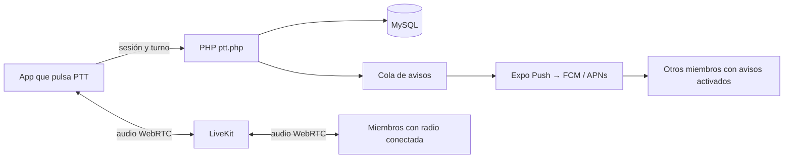

# Radio PTT en vivo y avisos de grupo

## Estado y alcance

La app anterior enviaba `burst-...` y metadatos a `voice-messages.php`; no capturaba
ni transportaba voz. La ruta pública consultada devolvió 404 sin cabecera de origen
CORS. Ahora el control utiliza `ptt.php` y el audio circula por WebRTC/LiveKit.
`voice-messages.php` responde 410 con CORS para que una app antigua no anuncie una
transmisión inexistente. No se guardan grabaciones ni se ofrece reproducción de
transmisiones pasadas en esta etapa.

La implementación permite conectar la radio, escuchar el grupo seleccionado y
publicar el micrófono mientras se mantiene pulsado PTT. La captura se prepara al
pulsar, pero el audio no se publica hasta que el servidor concede el turno. El cliente corta su track al soltar,
salir de PTT, perder foco, cambiar de sesión/grupo o pasar a segundo plano mientras
habla. La escucha continúa mientras el sistema permite mantener la conexión.

- **Web:** necesita permiso de micrófono y, si el navegador lo bloquea, tocar
  “Activar audio”. Una pestaña suspendida o cerrada no equivale a una radio móvil.
- **Android instalado:** módulo local `walkiet-radio-service` con foreground
  service de micrófono/reproducción y notificación persistente. Se inicia desde
  la app visible al tocar “Conectar radio”. No reinicia una app forzada a cerrar.
- **iPhone instalado:** audio WebRTC y modos de audio/notificación en segundo
  plano configurados. Esto permite una sesión de audio activa, pero **NO implementa
  todavía Apple Push to Talk/APNs `pushtotalk`**. Si iOS suspende la app inactiva,
  la notificación normal permite abrirla; no garantiza despertar y reproducir
  voz automáticamente. Esa integración nativa y su firma son trabajo pendiente
  para completar la recepción tipo walkie-talkie con pantalla bloqueada en iOS.
- **Avisos:** registro Expo Push por cuenta/sesión, cola persistente y envío a
  dispositivos de otros miembros del grupo. El proveedor real exige configurar
  FCM/APNs/EAS y probar dispositivos físicos. “Aceptado” en la cola significa
  aceptado por Expo, no confirmado por el teléfono.

No considerar terminada la prueba de segundo plano en ambos sistemas hasta
provisionar servicios y verificarla físicamente. Expo Go no contiene los módulos
WebRTC/notificaciones necesarios: hace falta una compilación propia.



## 1. Servicio de audio

Crear un proyecto LiveKit Cloud o proporcionar un despliegue LiveKit administrado.
La URL tiene formato `wss://nombre.livekit.cloud`. Las claves API se configuran
solo en PHP; no usar variables `EXPO_PUBLIC_` para ninguna clave privada.

Copiar [`ptt-config.example.php`](ptt-config.example.php) a **`/home/walkiet/private/ptt-config.php`**, fuera
de `www`, y poner los valores `url`, `key` y `secret`. Alternativamente configurar
`LIVEKIT_URL`, `LIVEKIT_API_KEY`, `LIVEKIT_API_SECRET` en el proceso PHP **y** en el
servicio worker. `WALKIET_PTT_CONFIG` permite indicar otra ruta privada al archivo.
`EXPO_ACCESS_TOKEN` se utiliza si se habilita la protección del servicio Expo Push.
No pegar claves en chat ni publicarlas en GitHub.

Los tokens de sala duran cinco minutos, limitan a una sala y arrancan con
`canPublish=false`. LiveKit Cloud revoca tokens al quitar participantes/actualizar
permisos. En un servicio autoalojado se debe revisar su política de revocación:
un token ya emitido puede seguir siendo válido hasta vencer aunque se quite al
participante. La validación de membresía del control PHP siempre se mantiene.

LiveKit Cloud incluye el transporte de medios y relay TURN. Si se autoaloja,
configurar certificados, puertos y TURN/TCP/TLS según su documentación; un PHP en
hosting compartido no sustituye al servidor multimedia. No desactivar políticas
de seguridad del navegador ni verificación TLS para resolver conectividad.

## 2. Base de datos y PHP en Alwaysdata

Aplicar [`004_live_ptt.sql`](migrations/004_live_ptt.sql) después de `002_private_contacts.sql` en la
misma BD de `conexion.php`. Es repetible y toma tipo/collation de `users.id` y
`channels.id`; no cambia cuentas, grupos ni mensajes existentes.

Subir juntos, al directorio público que contiene `conexion.php`:

- [`ptt.php`](ptt.php), [`ptt-handler.php`](ptt-handler.php), [`ptt-livekit.php`](ptt-livekit.php), [`ptt-worker.php`](ptt-worker.php).
- [`voice-messages.php`](voice-messages.php) y [`.htaccess`](.htaccess) actualizados.
- [`api/ptt.php`](api/ptt.php) si se usan los proxies `/api/*.php`.

Conservar `auth-session.php`, `cors.php`, `conexion.php` de la agenda privada.
El archivo con claves va fuera del directorio público. No sustituir la conexión
por la fixture de pruebas ni reimportar el esquema completo sobre datos reales.

Crear un **servicio supervisado** en Alwaysdata con el comando:

```sh
php /home/walkiet/www/ptt-worker.php
```

Usar la versión PHP de tu sitio y el directorio real de instalación. El servicio
hereda la misma configuración privada y BD. No ejecutarlo desde una URL. Un cron
cada minuto no proporciona la misma respuesta que el servicio continuo.

El worker revoca turnos vencidos y participantes con sesión o membresía inválida,
y procesa avisos pendientes. Si lleva más de 15 segundos sin registrar actividad,
el servidor rechaza nuevas conexiones/turnos con 503. No se debe omitir el worker.
Revisar el log PHP por el prefijo `PTT API:`/`PTT worker:` sin divulgar claves.

## 3. Compilación Android e iPhone

Después de actualizar la rama:

```sh
npm install
npx expo start --dev-client -c
```

Ese comando sirve el JavaScript a una **app de pruebas ya instalada**. Para crearla,
configurar un proyecto Expo/EAS y su ID público `EXPO_PUBLIC_EAS_PROJECT_ID`.
`app.config.ts` lee ese valor al compilar. Mantener su valor en `.env.local` o en
el entorno EAS. Configurar FCM v1 para Android y APNs para iOS con las herramientas
seguras de Expo/EAS; las credenciales privadas no se suben al repositorio.

Para Android, `GOOGLE_SERVICES_JSON` debe apuntar al `google-services.json` de la
app, preferiblemente como variable de archivo de EAS. Esto no sustituye las
credenciales FCM v1 del servicio push. Para iPhone hace falta firma de Apple y un
dispositivo físico registrado en la distribución interna.

```sh
npx eas-cli build --platform android --profile development
npx eas-cli build --platform ios --profile development
```

`eas.json` también incluye `preview` para instalación interna. Las cuentas,
proyectos, credenciales y firmas deben aprovisionarse antes de lanzar los builds.
No se creó un proyecto cloud ni se generó una compilación firmada automáticamente.

En cada teléfono, con cuentas distintas para la prueba: iniciar sesión, seleccionar el mismo grupo, tocar **Conectar
radio** y **Activar avisos de los grupos**. Mantener PTT pulsado en uno y verificar
que el otro escucha mientras se habla. La notificación de actividad abre el grupo
y valida otra vez que la cuenta siga siendo miembro.

Para usar el servidor Node de desarrollo como proxy del control, configurar
`PTT_PHP_ORIGIN=https://walkiet.alwaysdata.net` y utilizar la misma BD/sesiones.
No hay una segunda implementación de turnos ni éxito simulado en almacenamiento
local Node. La autoridad es el endpoint PHP configurado.

## Control y revocación

- Identidad de cuenta desde `auth_sessions`, nunca desde `sender_id` del cuerpo.
  Cada conexión tiene identidad aleatoria independiente para que una respuesta
  de desconexión anterior no cierre una conexión nueva.
- SQL con bloqueo de fila concede un turno por grupo. `transmission_id` hace que
  repeticiones y liberaciones tardías no alteren otra pulsación. Tanto `start`
  como `heartbeat` y `stop` validan membresía; no hay excepción pública para
  usuarios que abandonaron el canal.
- Permiso de publicación confirmado por la API de LiveKit antes de emitir voz;
  fallo de concesión no genera éxito local. Si hay un timeout ambiguo se intenta
  revocar y se conserva el turno vencido para la limpieza supervisada si hace falta.
- Lease de 12 segundos, heartbeat cada cuatro y pulsación de hasta 45 segundos.
  Al soltar se detiene el track local inmediatamente y se revoca en el servidor.
  El worker limpia incluso cuando el dispositivo no envía `stop`.
- Cambiar cuenta/grupo descarta respuestas anteriores. El cambio de membresía o
  revocación de sesión provoca expulsión del participante mediante el worker.
- Avisos solo después de confirmar la publicación del micrófono en LiveKit, a registros de dispositivo con sesión válida de otros miembros,
  con IDs de evento únicos y reintentos acotados. Se omiten dispositivos ajenos y
  el emisor. Un cierre de sesión impide encolar nuevos avisos a su registro.
  Un push aceptado previamente por el proveedor no puede retirarse del teléfono.
  El worker purga registros de avisos con más de 24 horas y dispositivos con
  sesiones inválidas en lotes acotados; la cola no es un archivo de mensajes.

## Pruebas reproducibles

Usar exclusivamente MySQL/MariaDB local con la preparación de
`tests/fixtures/README.md` y `groups-mysql.ts`. Luego:

1. `CONTACTS_TEST_SOCKET=/ruta/mysql.sock php tests/fixtures/ptt-mysql.php` crea
   exclusivamente `contacts_test_ptt`, con A/B miembros y C ajeno. Recrear esta
   fixture antes de pruebas aisladas.
2. Preparar el backend temporal con `prepare-private-backend.php` y
   `CONTACTS_TEST_DSN` apuntando a `contacts_test_ptt`. Iniciar PHP en
   `127.0.0.1:8101`.
3. Iniciar un LiveKit local, con `LIVEKIT_URL=ws://127.0.0.1:7880`, claves
   **sintéticas** y `WALKIET_PTT_TESTING=1` en PHP y worker. Los URL `ws://` solo
   se admiten en localhost bajo ese modo de pruebas. Si el navegador restringe
   UDP directo, configurar TURN/TCP local; conservar su política administrada.
4. `node tests/fixtures/ptt-push-server.mjs` inicia el proveedor controlado en
   `127.0.0.1:8102`. Usar `WALKIET_PTT_PUSH_TEST_URL=http://127.0.0.1:8102` y modo
   de pruebas para que ningún aviso salga a Expo/FCM/APNs reales.
5. Iniciar el worker del **directorio temporal**, cuya conexión apunta a la BD
   sintética. No ejecutar el worker del repositorio con conexion.php de producción.
6. Ejecutar `npm run build` y `npm run preview`.
7. `PTT_TEST_BACKEND=http://127.0.0.1:8101 node tests/ptt-live-ui.mjs` comprueba
   WebRTC/Opus real entre dos contextos Chromium, paquetes recibidos y energía de
   audio decodificado, autorización, CORS, turno ocupado, liberación y respuesta
   tardía segura. `CONTACTS_TEST_SOCKET` añade una prueba de expiración del turno.
8. Con las variables sintéticas de LiveKit/DB ejecutar
   `php tests/ptt-backend.php`: permisos, rollback, expiración y revocación.

`PLAYWRIGHT_MODULE`, `CHROMIUM_PATH` y `PTT_UI_URL` permiten seleccionar las
herramientas locales. La captura de micrófono en la prueba es sintética de
Chromium; el transporte y decodificación son reales. La entrega push se verifica
contra un proveedor controlado. No se probó recepción real APNs/FCM ni audio con
pantalla bloqueada de dispositivos físicos; el bundle JS iOS no sustituye un
build firmado ni la integración Apple Push to Talk pendiente.

Referencias oficiales:
[LiveKit/Expo](https://docs.livekit.io/transport/sdk-platforms/expo/),
[LiveKit en segundo plano](https://github.com/livekit/client-sdk-react-native#background-processing),
[Expo Push](https://docs.expo.dev/push-notifications/push-notifications-setup/),
[Apple Push to Talk](https://developer.apple.com/documentation/pushtotalk).
